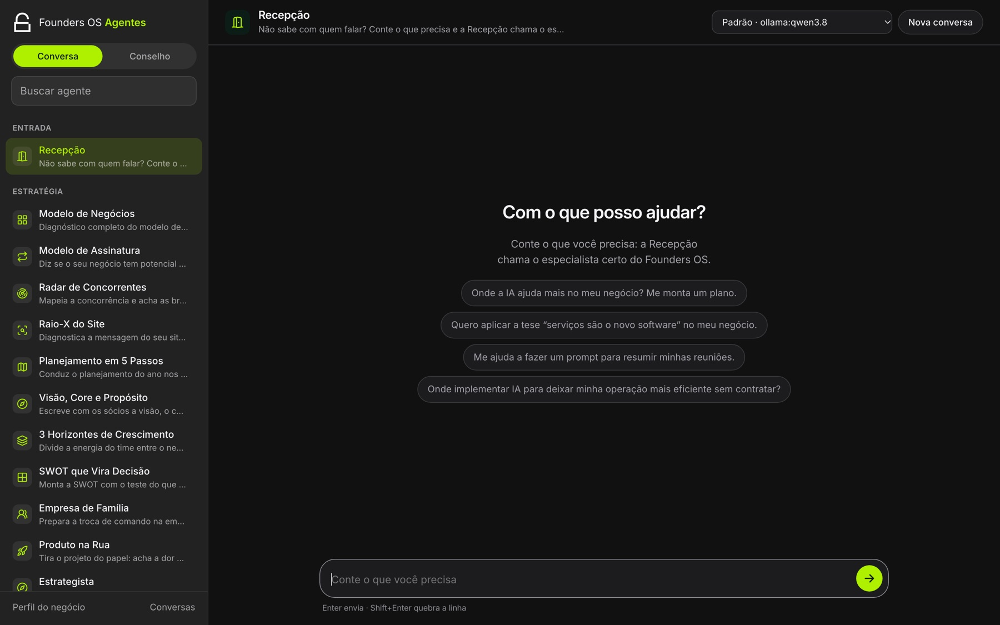
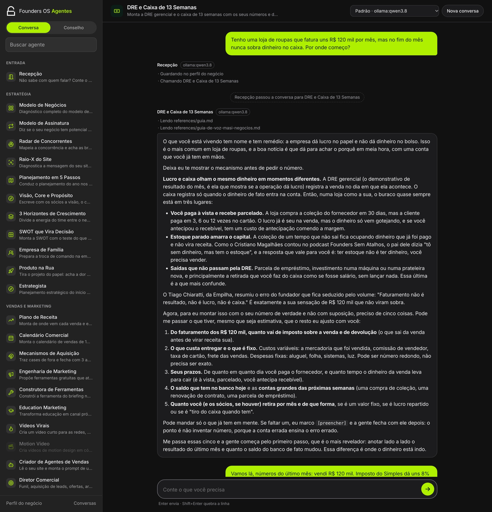
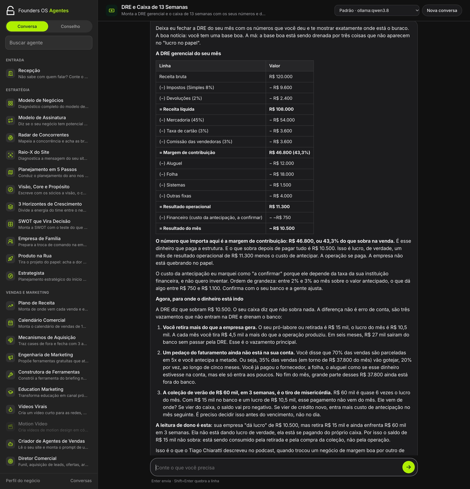
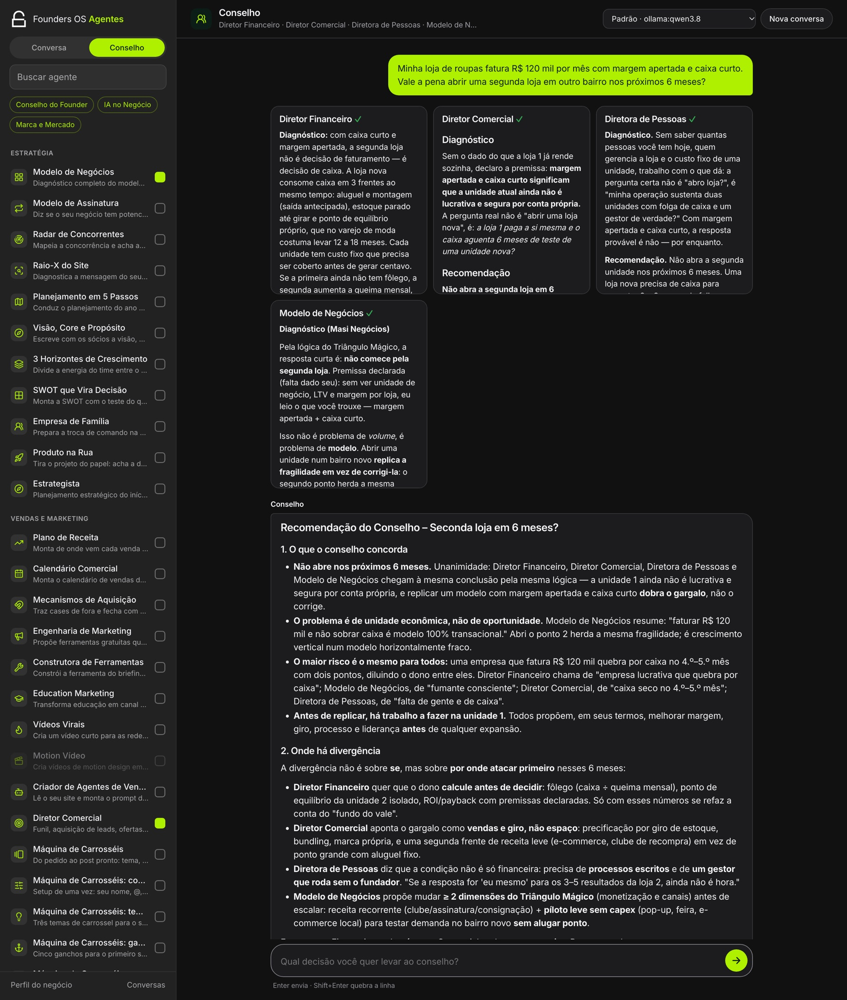
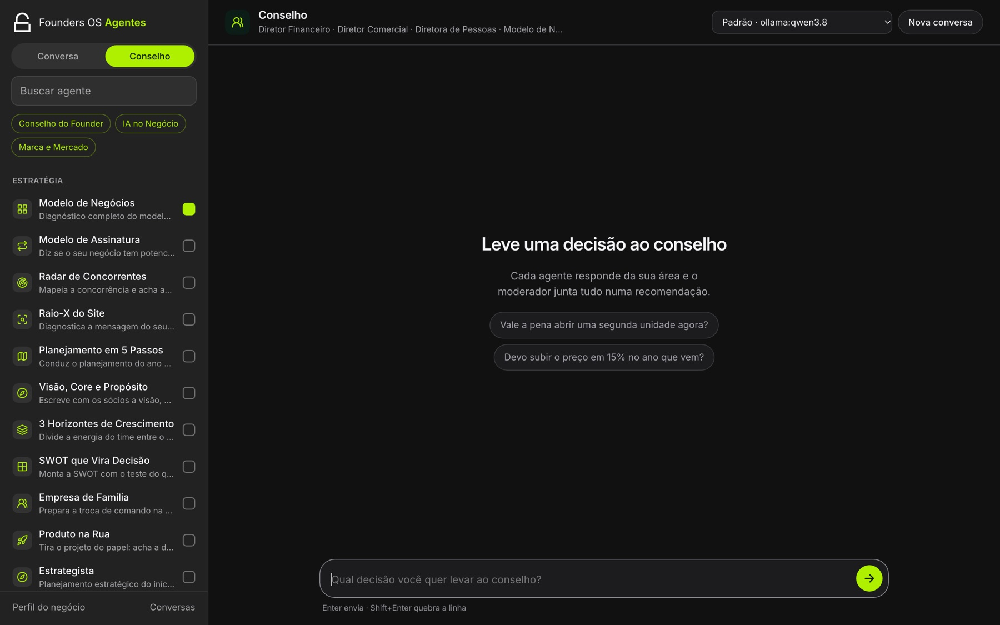
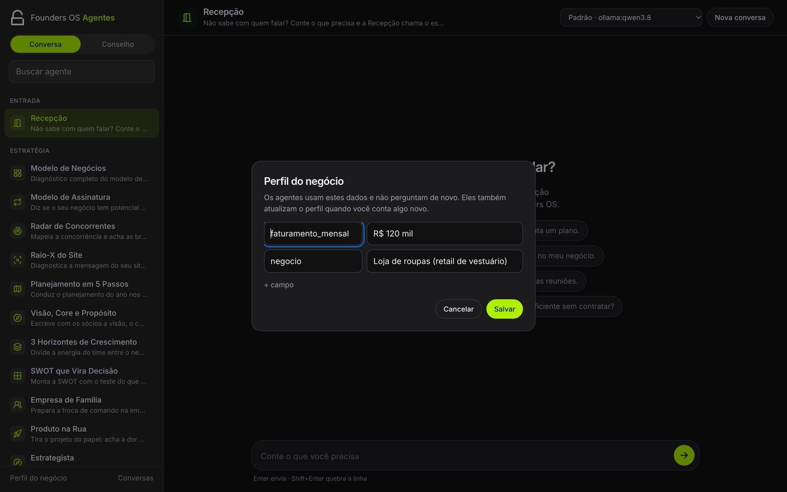
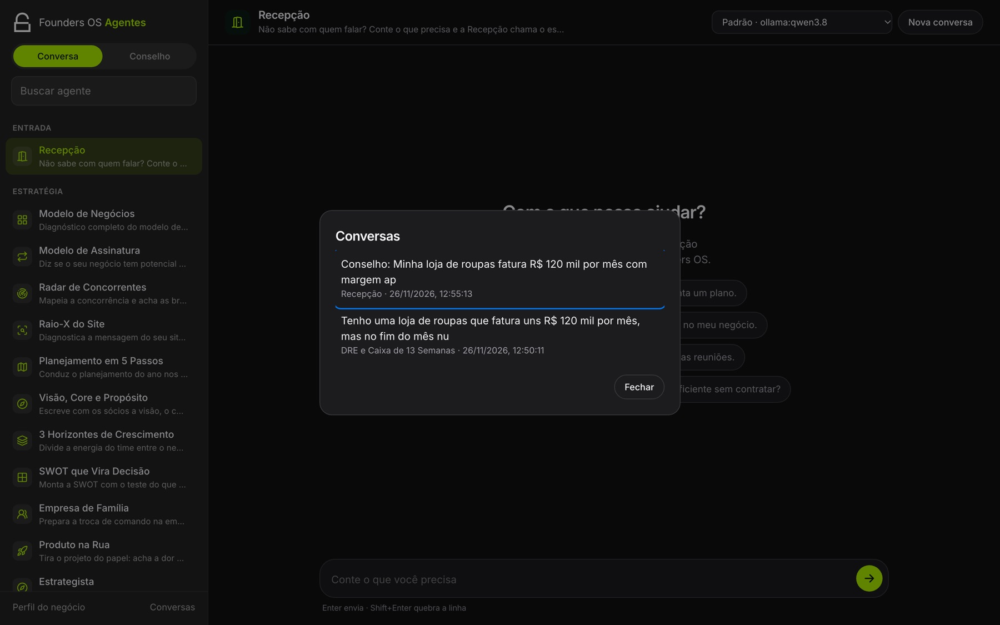
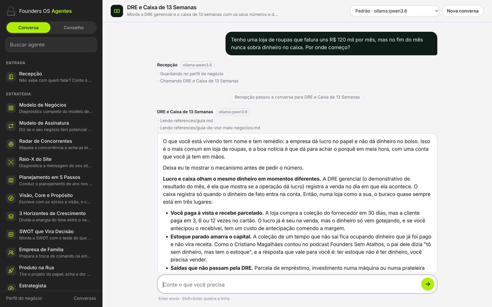
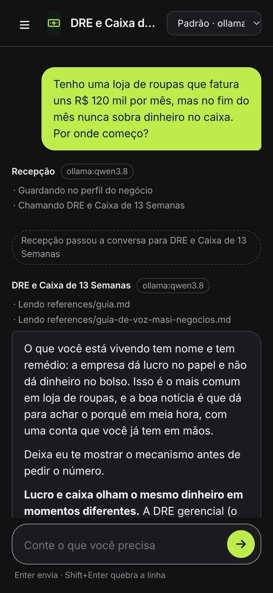
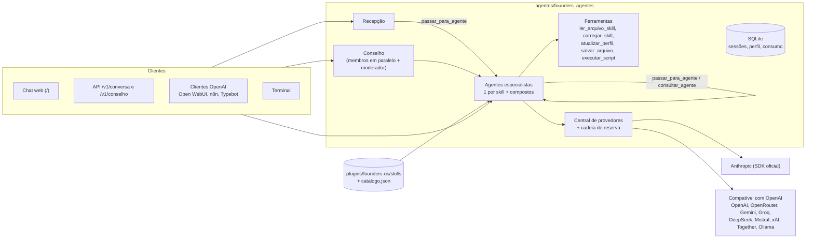

# Founders OS Agentes

Camada agêntica sobre as Skills do Founders OS. Cada skill vira um **agente** que o empresário usa fora do Claude, com **qualquer modelo** (Claude, GPT, Gemini, Llama, DeepSeek, Mistral, modelos locais no Ollama e as centenas do OpenRouter), por uma **conversa na web**, por **API**, por qualquer **cliente compatível com a OpenAI** (Open WebUI, LibreChat, n8n, Typebot, bots de WhatsApp) ou pelo **terminal**.

As Skills continuam sendo a fonte única das instruções: esta pasta só lê `plugins/founders-os/skills` e o `catalogo.json`. Mudou uma skill, basta reiniciar o serviço para o agente mudar junto, sem gerar nada.

## O que a camada acrescenta às Skills

| | Skills no Claude | Com a camada de agentes |
|---|---|---|
| Onde roda | App do Claude, claude.ai, Cowork, Claude Code | Qualquer modelo e qualquer cliente, inclusive o Claude |
| Qual especialista atende | O Claude escolhe pela descrição | A **Recepção** entende o pedido e passa para o agente certo |
| Trabalho em equipe | Uma skill por vez | Agentes **passam a conversa** entre si, **consultam** um colega e reúnem um **Conselho** em paralelo |
| Contexto do negócio | Cada skill pergunta de novo | **Perfil do negócio** compartilhado: faturamento, time, regime e público ficam guardados para todos os agentes |
| Composição | Cada skill isolada | **Agentes compostos** (skill principal + skills de apoio) e **times** |
| Resiliência | Um modelo | **Cadeia de reserva**: se um modelo falha, o próximo assume |
| Entregas | Arquivos na sessão do Claude | `salvar_arquivo` e, se ligado, os **scripts das skills** (ex.: planilha do Plano de Receita) com download pela API |
| Integração | Só pelo Claude | API com eventos ao vivo, endpoint compatível com a OpenAI, terminal |

## Telas

As telas abaixo usam respostas reais de um modelo rodando na própria máquina (`ollama:qwen3.8`), sem chave de API.

| | |
|---|---|
|  |  |
| **Recepção**: o catálogo inteiro por área e exemplos de pedido. | **Passagem**: a Recepção guarda o perfil e chama o especialista, que lê as referências da skill antes de responder. |
|  |  |
| **Resposta do especialista** com os números do usuário. | **Conselho**: quatro diretores respondem em paralelo e o moderador junta tudo. |
|  |  |
| **Modo Conselho**: times prontos ou de 2 a 6 agentes à escolha. | **Perfil do negócio** preenchido pelos próprios agentes. |
|  |  |
| **Conversas** salvas por dono, reabertas pelo link. | **Tema claro**, que segue o sistema. |

<p align="center"></p>

## Arquitetura



| Módulo | Papel |
|---|---|
| `skills.py` + `frontmatter.py` | Descobre as skills pelo marketplace, lê o frontmatter e o catálogo, troca `${CLAUDE_PLUGIN_ROOT}` por `skill://` e lê os arquivos sem sair da pasta da skill |
| `agentes.py` | Um agente por skill, a Recepção, agentes compostos e times da configuração |
| `prompts.py` | Monta o prompt: um bloco estável (guia da plataforma + SKILL.md + catálogo), que vai para o cache do provedor, e um bloco variável (data e perfil do negócio) |
| `ferramentas.py` | O que o agente pode fazer: ler arquivos e carregar skills sob demanda, passar a conversa, consultar outro agente, guardar o perfil, salvar arquivos e rodar scripts |
| `orquestrador.py` | O laço do agente (modelo → ferramentas → modelo), passagens, consultas e troca de modelo quando um falha, emitindo eventos ao vivo |
| `conselho.py` | Vários agentes respondem em paralelo e um moderador junta numa recomendação |
| `provedores/` | `claude.py` (SDK `anthropic`), `openai_compat.py` (biblioteca padrão, streaming SSE) e `demo.py` (responde sem IA) |
| `armazenamento.py` | Sessões, histórico, perfil do negócio por dono e consumo de tokens por modelo, em SQLite |
| `servidor.py` | API própria, endpoint compatível com a OpenAI e a interface web, só com a biblioteca padrão |

### Como uma skill vira agente

1. O corpo do `SKILL.md` entra no prompt do agente, junto com um guia curto que adapta o que só existe no Claude: perguntas do AskUserQuestion viram perguntas em texto, artefatos viram resposta no chat ou `salvar_arquivo`.
2. As referências (`references/`, `assets/`, `scripts/`) **não** entram no prompt: o agente lê cada uma com `ler_arquivo_skill` quando a skill manda, como o Claude faz.
3. Instruções do tipo "passe a bola para o Diretor Financeiro" viram `passar_para_agente`; o próximo agente recebe um resumo e não repete perguntas.
4. Skills que só rodam no Claude Code (hoje, `motion-video`) aparecem como indisponíveis.

## Começar

Precisa de Python 3.11 ou mais novo. Sem dependências para o núcleo.

```bash
cd agentes
python3 -m founders_agentes diagnostico
```

Para ver a interface sem chave de IA, no modo demonstração:

```bash
FOUNDERS_AGENTES_MODELO=demo:eco python3 -m founders_agentes servir
```

Abra http://127.0.0.1:8787. Escreva "@cfo" numa mensagem para ver a Recepção passar a conversa.

Com o Claude:

```bash
pip install "anthropic>=1,<2"
export ANTHROPIC_API_KEY=...
python3 -m founders_agentes servir
```

Com outro provedor, defina a chave dele e o modelo padrão, por exemplo `export OPENROUTER_API_KEY=...` e `export FOUNDERS_AGENTES_MODELO=openrouter:<modelo>`.

## Conectar modelos

O modelo se escreve `provedor:modelo`. Provedores prontos:

| Provedor | Tipo | Chave | Observação |
|---|---|---|---|
| `anthropic` | SDK oficial | `ANTHROPIC_API_KEY` (ou `ant auth login`) | Cache de prompt, raciocínio adaptativo, `effort` e fallback no servidor nos modelos que aceitam |
| `openai` | compatível | `OPENAI_API_KEY` | |
| `openrouter` | compatível | `OPENROUTER_API_KEY` | Uma chave para modelos de vários fornecedores |
| `gemini` | compatível | `GEMINI_API_KEY` | Endpoint compatível com a OpenAI do Google |
| `groq`, `deepseek`, `mistral`, `xai`, `together` | compatível | `<PROVEDOR>_API_KEY` | |
| `ollama` | compatível | nenhuma | Modelos locais; `OLLAMA_BASE_URL` muda o endereço |
| `demo` | interno | nenhuma | Responde sem IA, para testar |

Na configuração (`agentes/config.toml`):

- `[modelos] padrao` vale para todos os agentes; `reserva` é a lista tentada quando o modelo falha (sem chave, fora do ar, limite de uso). Se a falha vier no meio da resposta, o texto recomeça no modelo seguinte e o cliente recebe o evento `reinicio`.
- Cada agente pode ter `modelo`, `modelos_reserva` e `esforco` próprios. Por exemplo, o CFO num modelo de raciocínio e a Recepção num modelo rápido.
- `[modelos.apelidos]` cria nomes curtos, que aparecem no seletor de modelo da interface.
- Qualquer outra API no formato Chat Completions entra como `[provedores.nome]` com `tipo = "openai_compat"`, `base_url` e `chave_env`.

No provedor `anthropic`, o fallback no servidor (beta `server-side-fallback-2026-07-01`, `fallbacks = "default"`) fica ligado nos modelos que o aceitam: se o modelo recusar o pedido por segurança, a própria API refaz com outro modelo. Para desligar, use `[provedores.anthropic]` com `fallbacks = ""`.

## Agentes compostos e times

```toml
[[agentes]]
id = "cfo"
nome = "CFO de Bolso"
area = "Finanças"
skill_principal = "diretor-financeiro-masinegocios"
skills_apoio = ["guia-dre-e-caixa", "guia-cac-ltv-payback", "gerador-plano-receita"]
modelo = "anthropic:claude-opus-5-5"
esforco = "high"

[[times]]
id = "conselho-do-founder"
nome = "Conselho do Founder"
agentes = ["diretor-financeiro-masinegocios", "diretor-comercial-masinegocios", "diretora-de-gente-masinegocios"]
```

Um `[[agentes]]` com o mesmo id de uma skill muda só aquele agente (modelo, esforço, para quem pode passar a conversa, ferramentas). `desativado = true` tira o agente do ar.

## API

Autenticação: `Authorization: Bearer <chave>` (ou `X-API-Key`). As chaves vêm de `FOUNDERS_AGENTES_CHAVES="chave:dono,..."`; cada dono tem suas conversas e seu perfil.

| Método | Rota | O que faz |
|---|---|---|
| GET | `/saude` | Situação do serviço (sem chave) |
| GET | `/v1/agentes`, `/v1/agentes/{id}` | Agentes por área, modelo efetivo, ferramentas |
| GET | `/v1/skills`, `/v1/times`, `/v1/provedores` | Catálogo, times e provedores configurados |
| GET | `/v1/sugerir?q=...` | Sugestão rápida de agentes por palavras, sem chamar modelo |
| POST | `/v1/conversa` | `{mensagem, sessaoId?, agente?, modelo?, stream?}` |
| POST | `/v1/conselho` | `{pergunta, agentes: [...] ou time, modelo?, stream?}` |
| GET/POST | `/v1/sessoes`, GET `/v1/sessoes/{id}` | Conversas do dono, histórico, consumo e arquivos |
| GET | `/v1/sessoes/{id}/arquivos/{nome}` | Download de um arquivo entregue pelo agente |
| GET/PUT | `/v1/perfil` | Perfil do negócio |

A interface web aceita links diretos, por exemplo para o site do catálogo abrir um agente: `/?agente=<id>`, `/?sessao=<id>` (a conversa fica no endereço, então recarregar não a perde), `/?modo=conselho&time=<id>` e `/?tema=claro` ou `/?tema=escuro`.

Com `stream` (padrão), a resposta chega em eventos SSE: `sessao`, `agente`, `texto`, `ferramenta`, `ferramenta_fim`, `passagem`, `consulta`, `arquivo`, `perfil`, `reinicio`, `aviso`, `recusa`, `erro`, `fim`; no Conselho também `conselho`, `membro_texto` e `membro_fim`. Com `"stream": false`, volta um JSON com o texto e a lista de eventos.

```bash
curl -N http://127.0.0.1:8787/v1/conversa \
  -H "Authorization: Bearer $CHAVE" -H "Content-Type: application/json" \
  -d '{"mensagem": "Vendo bem e não sobra dinheiro", "agente": "cfo"}'
```

### Compatível com a OpenAI

`GET /v1/models` lista os agentes como modelos e `POST /v1/chat/completions` conversa com eles. `auto` é a Recepção.

- Sem `X-Session-Id`, funciona como um modelo comum: o cliente manda o histórico a cada pedido.
- Com `X-Session-Id` (ou `metadata.session_id`), a camada guarda a conversa e respeita as passagens entre agentes; o cliente manda só a última mensagem.

No Open WebUI, por exemplo: Conexões › OpenAI › URL `http://SEU_HOST:8787/v1` e a chave de `FOUNDERS_AGENTES_CHAVES`. Os agentes aparecem na lista de modelos.

## Terminal

```bash
python3 -m founders_agentes agentes                       # lista por área
python3 -m founders_agentes conversar cfo                 # conversa interativa
python3 -m founders_agentes perguntar "meu caixa não fecha"
python3 -m founders_agentes conselho --time conselho-do-founder "Abro a segunda unidade agora?"
python3 -m founders_agentes sugerir "quero vender por assinatura"
```

## Subir em produção

```bash
cp agentes/.env.example agentes/.env   # preencha as chaves
docker compose -f agentes/docker-compose.yml up --build -d
```

- A imagem leva as Skills, o catálogo e a camada; os dados ficam no volume `/dados`.
- Exposto na rede, o servidor não sobe sem `FOUNDERS_AGENTES_CHAVES`.
- Atrás de proxy (Nginx, Caddy, Cloudflare), deixe o streaming sem buffer: a API já manda `X-Accel-Buffering: no`.
- O servidor usa a biblioteca padrão do Python e SQLite: atende bem uma instância. Para várias instâncias, o próximo passo é trocar o armazenamento por um banco compartilhado.

## Segurança

- Leitura de arquivos presa à pasta de cada skill; nada fora dela.
- Scripts das skills **desligados** por padrão. Ligados (`FOUNDERS_AGENTES_SCRIPTS=1`), rodam só arquivos `.py` de `scripts/`, na pasta da conversa, com tempo limite e argumentos sem caminhos absolutos. Ligue apenas em container.
- Sessões, arquivos e perfil separados por dono (chave de API).
- As Skills são conteúdo da Masi Negócios (veja `LICENSE`); oferecer os agentes para terceiros segue a mesma licença.

## Testes

```bash
cd agentes
python3 -m unittest discover -s tests -t tests
```

Os testes usam skills de exemplo próprias (`tests/fixtures`) e provedores simulados, sem rede nem chave.
